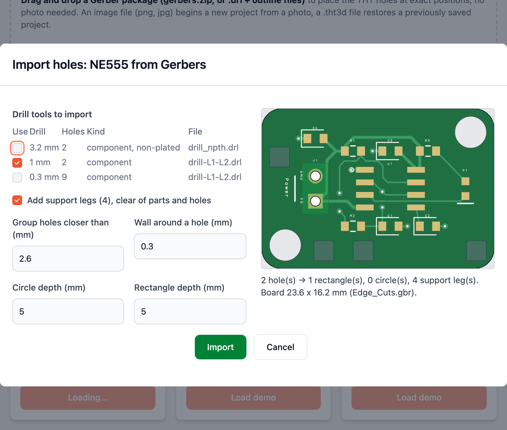
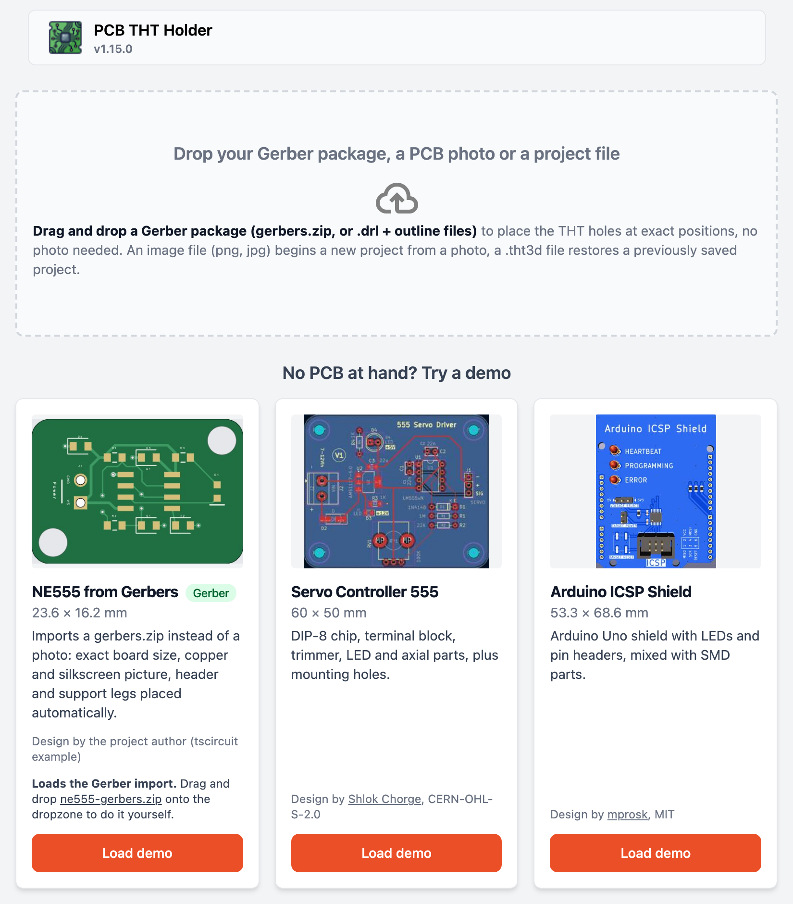
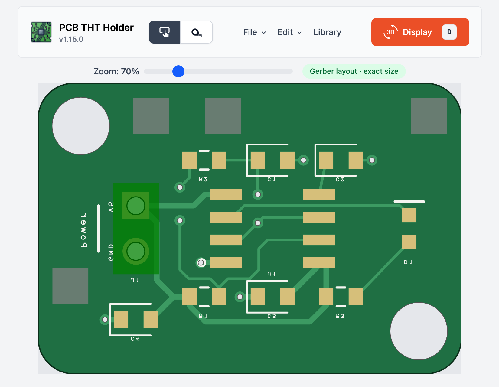
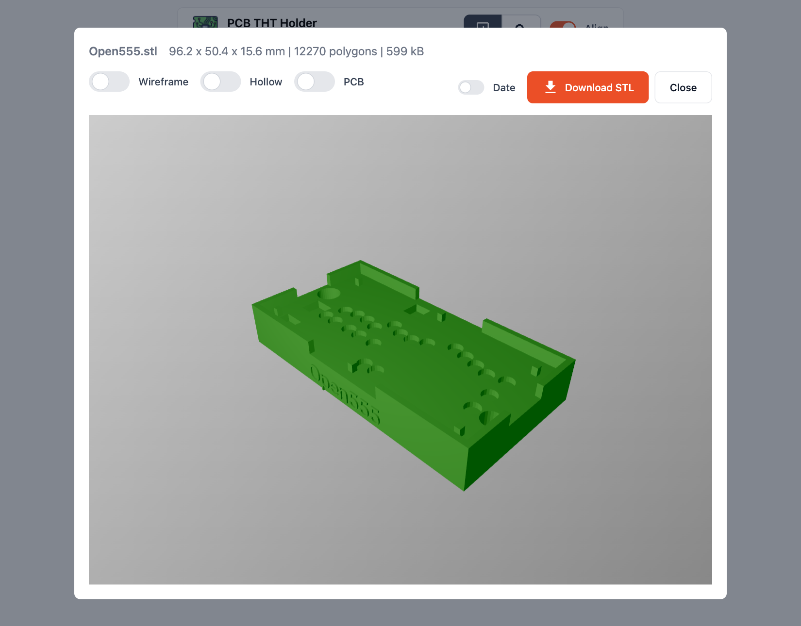
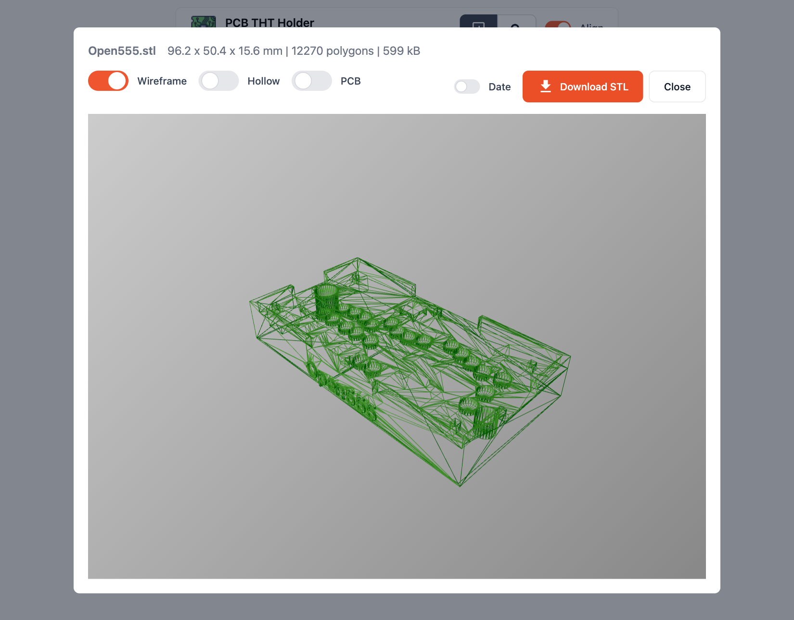

# PCB THT holder

[](https://skipthecad.com/generators/pcb-tht-holder/)

[Changelog](CHANGELOG.md)

3D STL file generator for THT PCB panels, online access: https://segmentcontroller.github.io/pcb-tht-holder/

I make almost all of my printed circuit boards with online design software and entrust the manufacturing company to install the SMD components. I install the THT (through hole technology) components at home for two reasons:

- What they charge for meticulous manual work cannot be called cheap.
- Not all THT parts are needed, in many cases only 2 of the 6 relays are installed. This can reduce costs.

> I would also like to do the THT installation at home nicely. However, with many panels there are "traces of haste".

## That's why I created an **online tool** that:

- **Reads your Gerber / Excellon fabrication files** (`gerbers.zip`): the THT holes land at exact coordinates on a board of exact size, no photo, no measuring.
- Or, based on the photo of the PCB, it helps to leave the place of the protruding (THT) parts empty.
- It creates a 3D format (STL) output that, if you print, will keep the parts straight during soldering.
- It can work without registration and without uploading (and storing) a photo of the PCB.

In its current state, it facilitates the installation of circular and oblong components. This is sufficient in the following cases: **relays, capacitors, resistors, terminals and pin-headers.** It automatically calculates the required area and volume based on the height of the parts. But it doesn't mean that there aren't any mistakes in it: if you experience anything, I welcome your comments.

## Start from your Gerber files

> **Drag and drop the `gerbers.zip` you send to the PCB manufacturer** onto the page. That is the whole setup.

Every CAD tool produces this package for the board house, so the holder can be derived from data you already have:

- **Exact size**: the panel takes the size of the board outline (`Edge.Cuts` / board outline layer).
- **Exact holes**: every drilled hole sits at its real coordinates; neighbouring holes of the same diameter are grouped into one part (a pin header becomes one rotated rectangle, a lone hole becomes a circle).
- **Review dialog**: lists the drill tools (plated lead-size holes on by default, vias and mounting holes off), the grouping distance, **optional support legs** placed clear of SMD pads, silkscreen and holes, and a preview of the board.
- **A rendered board as the picture**: top copper, exposed solder-mask pads, silkscreen, outline and holes, drawn opaque instead of a semi-transparent photo.
- **Loose files work too**: `.drl` / `.xln` Excellon or Gerber drill files plus the outline layer.
- **Any CAD**: KiCad, Altium/Protel, Eagle, OrCAD, gEDA, DipTrace, EasyEDA/JLC, OSH Park and others; Gerber X2 attributes are used when present, file naming otherwise. Follows the Ucamco Gerber Layer Format and XNC drill specifications (apertures and macros, step and repeat, arcs, regions, polarity, slots, inch/metric).
- **Private**: parsing, rendering and the 3D generation run in your browser; your fabrication files never leave it.



No Gerber files at hand? The **NE555 from Gerbers** demo under the dropzone runs a sample package through exactly the same import, and its `gerbers.zip` can be downloaded from the card so you can try the drag and drop yourself.

### Photo or Gerber project?

The project starts either way, and the app shows which one you have:

|                           | Started from Gerber files                                            | Started from a photo                                                  |
| ------------------------- | -------------------------------------------------------------------- | --------------------------------------------------------------------- |
| Picture                   | Rendered top view (copper, solder mask openings, silkscreen), opaque | Your photo, drawn at 25 % opacity                                     |
| Panel size                | Exact, taken from the board outline                                  | Unknown scale: you enter the real width, the photo is stretched to it |
| Holes                     | Placed at exact coordinates, neighbours grouped into parts           | You place and size every element by hand                              |
| Support legs              | Suggested automatically in the import dialog                         | You add them by hand                                                  |
| Indicator in the designer | Green badge _Gerber layout · exact size_                             | Blue badge _Photo overlay · scale from settings_                      |
| Project settings          | Green note: _Exact size from the Gerber board outline_               | Blue note: _Photo has no scale_                                       |

## Features

- **Gerber / Excellon Import**: **Drag and drop your `gerbers.zip`** (or `.drl` + outline files): THT holes are placed at exact coordinates and grouped into parts, the panel gets its exact size from the board outline, support legs are suggested, no photo needed (see [Start from your Gerber files](#start-from-your-gerber-files))
- **Component Shapes**: Support for circular and rectangular components
  - Rectangles support full 360° rotation (0-359 degrees)
  - Flip dimensions to swap width/height instantly
- **Alignment Guides with Magnetic Snapping**: Visual guides and automatic snapping for precise component placement
  - Blue lines appear when elements align with centers or edges of other components
  - Elements automatically snap within 0.2mm of alignment points during drag
  - Toggle on/off with the Align checkbox in the Edit menu
  - Works on both X and Y axes independently for accurate positioning
- **Smart Leg Placement**: Automatic collision detection for support legs
  - Legs overlapping with components are automatically filtered during mesh generation
  - Warning notification shows count of hidden legs
  - Prevents mesh generation errors and ensures clean STL output
- **Print-ready STL**: Exported meshes are watertight and consistently oriented
  - A repair pass after the CSG operations welds seams, splits T-junctions and closes small holes
  - Slicers such as Bambu Studio import the file without "open edges" warnings or a repair step
- **Print Tolerance**: Adjustable tolerance setting (0-2mm with 0.1mm precision)
  - Compensates for 3D printer dimensional inaccuracies
  - Enlarges component holes and shrinks holder panel for perfect fit
- **Responsive Mesh Generation**: Real-time progress tracking during 3D mesh generation
  - Meshes are generated in a Web Worker, so the UI never freezes, even with 100+ components
  - Variants (Main, Hollow, PCB preview) are generated on demand and reused until the project changes
  - Closing the 3D view cancels a running generation
  - Progress bar shows percentage and visual indicator
- **Measurement Tool**: Press `M` to measure distances in 1/10th millimeter precision
- **Canvas Zoom**: 10-300% with the slider, `+` / `-` / `*` keys, or `Ctrl`/`Cmd` + mouse wheel (trackpad pinch)
  - The point under the cursor stays in place while zooming; scroll to pan a zoomed-in canvas
- **Comprehensive Undo/Redo System**: Press `Ctrl+Z` to undo and `Ctrl+Shift+Z` / `Ctrl+Y` to redo (max 50 actions)
  - The Edit menu lists Undo and Redo with the number of available steps
  - A new change after an undo discards the redo history
  - Component deletions (circles, rectangles, legs)
  - Property modifications (radius, depth, width, height, rotation)
  - Rectangle rotation (`R` key) and dimension flip (`F` key)
  - Element moves: one step per mouse drag, and holding an arrow key counts as one step
  - Visual error notifications for failed undo operations
  - Automatic stack clearing on project reset
- **Component Library**: Save and reuse your favorite component configurations
  - Pre-defined library with 13 common THT components (DIP sockets, capacitors, buzzers, terminals, relays)
  - One-click loading of standard footprints with datasheet-sourced dimensions
  - Import/export library as JSON for backup or sharing
  - Clear library with confirmation for fresh start
- **Keyboard Shortcuts**: Extensive keyboard shortcuts for efficient workflow
- **Hover Info**: Real-time element information and available shortcuts when hovering
- **Hollow Option**: Generate top-layer-only coverage for faster printing
- **Custom Labels**: Print text labels on the side of your holder
- **Demo Projects**: Three ready-made boards under the dropzone to try the workflow without a PCB, one of them started straight from a `gerbers.zip`
- **Auto Image Resize**: Automatically resizes large images (>1280x1024) for easier handling
- **PWA Support**: Install as a standalone application on your device
- **Offline Ready**: Works without internet connection after first load (service worker precaches the app shell)

## Keyboard Shortcuts

### Mode Selection

- `P` - Pointer mode (select and move elements)
- `M` - Measure mode (measure distances on PCB)

### Creating Elements

- `Shift+C` - Add new circle
- `Shift+R` - Add new rectangle
- `Shift+L` - Add new support leg

### Editing Elements (when element is selected)

- **Movement**:
  - `Arrow keys` - Fine move 0.1mm
  - `Shift+Arrow keys` - Move 0.5mm (5x faster)
- **Rectangle Rotation**:
  - `R` - Rotate +5°
  - `Shift+R` - Reset rotation to 0°
  - `F` - Flip dimensions (swap width/height)
- **Context Menu**: Right-click on any element; use `Arrow keys` / `Home` / `End` to navigate it and `ESC` to close it

### View

- `+` / `-` - Zoom in / out by 10%
- `*` - Reset zoom to 100%
- `Ctrl+Wheel` / `Cmd+Wheel` / trackpad pinch - Zoom at the cursor

### Other

- `Ctrl+Z` / `Cmd+Z` - Undo last operation (deletions, property edits, rotations, flips, moves)
- `Ctrl+Shift+Z` / `Cmd+Shift+Z` / `Ctrl+Y` - Redo the last undone operation
- `Shift+P` - Project settings
- `D` - Display 3D mesh
- `ESC` - Close modal dialogs
- `Double-click` - Edit element properties

## Try your first PCB to STL

Click here: https://segmentcontroller.github.io/pcb-tht-holder/

### Set up the project

**Best: drag and drop the fabrication `gerbers.zip`** (or the `.drl` drill files together with the `Edge.Cuts` layer). The import dialog lists the drill tools (vias and mounting holes are off by default), groups neighbouring holes (default: closer than 2.6 mm, e.g. a pin header becomes one rectangle), offers support legs and shows a preview. The panel takes the size of the board outline and all elements sit at their exact positions; THT parts that are missing from the BOM/pick-and-place files are fine, only the drill files matter.

**No Gerber files, only a picture?** Enter a PCB image with drag and drop or file selection, which will automatically flip and become transparent; you set the real width and place the elements yourself.

No PCB at hand? Pick one of the three demo boards under the dropzone: it loads a ready-made project with its holes and support legs already placed. _NE555 from Gerbers_ was started from a `gerbers.zip`; its package is offered on the card so you can try the drag and drop yourself. Demo credits and licences: [`public/demo/CREDITS.md`](./public/demo/CREDITS.md).



### Place the components

Gerber projects arrive with the holes already placed: check the depths and heights so that they are flush with the PCB. With a photo, place the THT parts by placing circles or squares and adjust their height/depth exactly. At the end, if necessary, add (or adjust) legs to support the PCB.



### Generate a 3D design in STL format

Click the Display 3D button and see the generated mesh. Rotate it, check that all components are in place. At the end, download the STL file (binary format).



### Check as a wireframe if necessary

If you want to analyze the location of the components, you can also see how things fit in the wireframe view.



### Print it with a 3D printer...

Use a PLA printer to save time and money. Practice shows that it is enough to produce the STL file once, of which 1-3 prints are enough to implant hundreds of PCBs.

## Development

### Tech Stack

- **Framework**: Svelte 5 with TypeScript (rune syntax: `$props()`, `$state()`, `$derived()`)
- **Build Tool**: Vite (Tailwind via `@tailwindcss/vite`)
- **3D Rendering**: Three.js with @threlte/core
- **3D Operations**: three-bvh-csg for CSG boolean operations
- **2D Canvas**: Konva.js for component placement
- **Fabrication files**: own pure TypeScript Gerber (RS-274X / X2) and Excellon/XNC parsers in `src/lib/gerber/`, zip extraction with `fflate`
- **UI**: Flowbite Svelte with Tailwind CSS 4
- **State**: Svelte stores persisted to local storage
- **Testing**: Vitest (unit tests run in Node, co-located as `*.test.ts`)

### Requirements

- Node.js >= 24.0.0
- npm >= 11.0.0

### Local Development

```bash
# Install dependencies
npm install

# Start development server (accessible on network)
npm run dev

# Run unit tests (Vitest)
npm run test

# Run tests in watch mode
npm run test:watch

# Run type checking
npm run ts:check

# Run linting
npm run lint:check

# Format code
npm run format:fix

# Build for production
npm run build

# Run all checks (format, lint, types, tests) and build
npm run all
```

### Project Structure

- `src/` - Source code
  - `components/` - Svelte components
  - `lib/` - Application logic
    - `lib/gerber/` - Gerber / Excellon import: parsers, plotter, hole grouping, support leg placement, board SVG renderer
    - `lib/3d/` - runs CSG in a Web Worker and repairs the result into a watertight mesh
    - `lib/designer/` - 2D canvas logic: alignment, fine movement, measurement, zoom, element operations
    - `lib/util/` - pure helpers (math, geometry, formatting, download)
  - `stores/` - Svelte stores for state management
  - `types/` - TypeScript type definitions and Zod schemas
- `public/` - Static assets
- `docs/` - Production build output (GitHub Pages)

### Contributing

See [CHANGELOG.md](CHANGELOG.md) for recent changes and version history.
